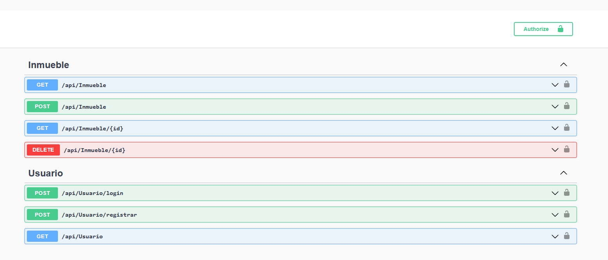
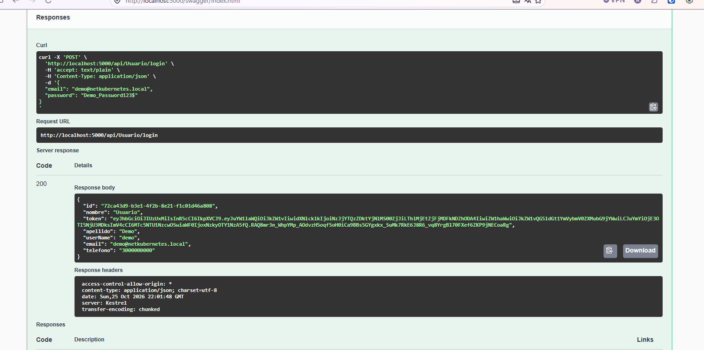

# NetKubernetes API

[Read this in English](README.md)

API REST de gestión de inmuebles construida con ASP.NET Core 7, con autenticación
basada en JWT y persistencia en SQL Server mediante Entity Framework Core. Corre en
contenedores con Docker, e incluye los manifiestos de Kubernetes del ejercicio de
orquestación.

Es el backend de [edificaciones-store-angular](https://github.com/Andersonporras/edificaciones-store-angular),
y lo construí como proyecto de aprendizaje para recorrer la cadena completa de una
API de verdad: autenticación con tokens, acceso a datos con un ORM, manejo de errores
centralizado, y empaquetado en contenedores.

## Estado del proyecto

Prefiero decir con claridad qué está probado y qué no:

- **Probado**: la API corriendo en local con `dotnet run` y en contenedor con Docker,
  contra SQL Server. Registro, login, el token, y los endpoints protegidos funcionan.
- **No probado**: nunca desplegué esto en un clúster de Kubernetes real. Los
  manifiestos de [`KubernetesApp/`](KubernetesApp/) son el ejercicio del curso que
  seguí; están revisados y corregidos, pero no los he aplicado en un clúster. Seguir
  por ese camino pedía una cuenta de nube con tarjeta de crédito y más recursos de
  máquina de los que tenía disponibles, así que paré ahí.

Lo dejo publicado porque escribir los manifiestos sí me enseñó cómo se piensa un
despliegue (ver [Qué aprendí](#qué-aprendí)), pero no quiero que se lea como
experiencia operando clústeres, porque no la tengo.

## Capturas



*Swagger UI: los siete endpoints agrupados por controlador. El candado marca los que
exigen token, y el botón **Authorize** permite pegarlo para probarlos.*



*`POST /api/Usuario/login` con el usuario de demostración: la respuesta trae el token
JWT que luego se usa en el header `Authorization`.*

## Características

- **Autenticación con JWT**: registro y login que devuelven un token firmado con HMAC-SHA512.
- **Protegido por defecto**: un filtro global de autorización exige token en todos los
  endpoints; los que deben ser públicos se marcan explícitamente con `[AllowAnonymous]`.
- **CRUD de inmuebles**: listar, consultar por id, crear y eliminar, con el inmueble
  asociado al usuario que lo creó.
- **Manejo de errores centralizado**: un middleware captura las excepciones y responde
  siempre JSON con el código HTTP correcto, en lugar de filtrar stack traces.
- **Migraciones automáticas al arrancar**: la aplicación aplica las migraciones de EF Core
  y siembra datos de prueba, reintentando mientras la base de datos termina de levantar.
- **Documentación interactiva**: Swagger UI con botón *Authorize*, para probar los
  endpoints protegidos pegando el token.
- **Configuración sin secretos en el repositorio**: la cadena de conexión y la clave del
  token se inyectan por variables de entorno, user-secrets o un `Secret` de Kubernetes.

## Tecnologías

| Área | Tecnología |
| --- | --- |
| Framework | ASP.NET Core 7 (Web API) |
| Lenguaje | C# |
| ORM | Entity Framework Core 6 |
| Base de datos | SQL Server 2022 |
| Autenticación | ASP.NET Core Identity + JWT (HMAC-SHA512) |
| Mapeo de DTOs | AutoMapper |
| Documentación | Swagger / Swashbuckle (OpenAPI) |
| Contenedores | Docker (build multi-etapa) + Docker Compose |
| Orquestación | Kubernetes — manifiestos escritos, no desplegados |

Al principio probé también **MySQL** con el proveedor Pomelo para ver qué tan
intercambiable es el motor en EF Core. Funcionó, pero me enfoqué en SQL Server; el
código de MySQL quedó comentado en `Program.cs` como referencia.

## Arquitectura

```
NetKubernetes/
├── Controllers/              # Endpoints HTTP: reciben, delegan, responden
│   ├── InmuebleController.cs
│   └── UsuarioController.cs
├── Data/                     # Acceso a datos (patrón repositorio)
│   ├── AppDbContext.cs       # DbContext sobre IdentityDbContext
│   ├── LoadDatabase.cs       # Siembra del usuario e inmuebles de demostración
│   ├── Inmuebles/            # IInmuebleRepository + implementación
│   └── Usuarios/             # IUsuarioRepository + implementación
├── Dtos/                     # Contratos de entrada y salida de la API
├── Middleware/               # Manejo global de excepciones
├── Migrations/               # Migraciones de EF Core
├── Models/                   # Entidades: Inmueble, Usuario
├── Profiles/                 # Perfiles de AutoMapper
├── Token/                    # Generación de JWT y lectura del usuario en sesión
├── KubernetesApp/            # Manifiestos de Kubernetes
├── Dockerfile
├── docker-compose.yml
└── Program.cs                # Composición: DI, autenticación, pipeline
```

El flujo de una petición es: el **controlador** recibe un DTO, el **repositorio**
hace el trabajo contra `AppDbContext`, **AutoMapper** convierte la entidad en DTO de
respuesta, y cualquier excepción la intercepta `ManagerMiddleware` para traducirla a
JSON con su código de estado.

La autorización va al revés de lo habitual: en vez de decorar con `[Authorize]` lo que
hay que proteger, `Program.cs` registra un `AuthorizeFilter` global y lo público se
marca con `[AllowAnonymous]`. Así, un endpoint nuevo nace protegido si uno se olvida.

## Endpoints

Base: `/api`. Todos requieren el header `Authorization: Bearer <token>` salvo los
marcados como públicos.

| Método | Endpoint | Público | Propósito |
| --- | --- | --- | --- |
| `POST` | `/api/Usuario/registrar` | Sí | Crea un usuario y devuelve sus datos con el token |
| `POST` | `/api/Usuario/login` | Sí | Autentica con email y contraseña, devuelve el token |
| `GET` | `/api/Usuario` | No | Devuelve el usuario dueño del token |
| `GET` | `/api/Inmueble` | No | Lista todos los inmuebles |
| `GET` | `/api/Inmueble/{id}` | No | Devuelve un inmueble; `404` si no existe |
| `POST` | `/api/Inmueble` | No | Crea un inmueble y responde `201` con su ubicación |
| `DELETE` | `/api/Inmueble/{id}` | No | Elimina un inmueble; `404` si no existe |

Ejemplo de login y uso del token:

```bash
# 1. Obtener el token con el usuario de demostración
TOKEN=$(curl -s -X POST http://localhost:5000/api/Usuario/login \
  -H "Content-Type: application/json" \
  -d '{"email":"demo@netkubernetes.local","password":"Demo_Password123$"}' \
  | python -c "import sys,json; print(json.load(sys.stdin)['token'])")

# 2. Consultar los inmuebles con ese token
curl -s http://localhost:5000/api/Inmueble -H "Authorization: Bearer $TOKEN"
```

Los errores siempre llegan con la misma forma:

```json
{ "errores": { "mensaje": "No se encontro el inmueble por este id 99" } }
```

## Configuración

El repositorio **no contiene credenciales**. La aplicación necesita dos valores y no
arranca sin ellos: falla de inmediato con un mensaje que dice qué falta.

| Clave | Variable de entorno | Qué es |
| --- | --- | --- |
| `ConnectionStrings:SQLServerConnection` | `ConnectionStrings__SQLServerConnection` | Cadena de conexión a SQL Server |
| `Jwt:Key` | `Jwt__Key` | Clave para firmar los JWT, mínimo 32 caracteres |

En desarrollo lo más cómodo es `dotnet user-secrets`, que guarda los valores fuera
del directorio del proyecto:

```bash
dotnet user-secrets init
dotnet user-secrets set "ConnectionStrings:SQLServerConnection" \
  "Data Source=localhost;Initial Catalog=InmuebleDB;User Id=sa;Password=TuPassword123$;TrustServerCertificate=True"
dotnet user-secrets set "Jwt:Key" "$(openssl rand -base64 48)"
```

## Puesta en marcha

Requisitos: [.NET 7 SDK](https://dotnet.microsoft.com/download/dotnet/7.0) y una
instancia de SQL Server accesible.

```bash
# Clonar y restaurar
git clone https://github.com/Andersonporras/NetKubernetes.git
cd NetKubernetes
dotnet restore

# Configurar los secretos (ver la sección anterior)
dotnet user-secrets init
dotnet user-secrets set "Jwt:Key" "una-clave-aleatoria-de-32-caracteres-o-mas"
dotnet user-secrets set "ConnectionStrings:SQLServerConnection" "..."

# Levantar
dotnet run
```

La API queda en `http://localhost:5000` y Swagger UI en
`http://localhost:5000/swagger`. Al arrancar aplica las migraciones y siembra dos
inmuebles y un usuario de demostración:

- **Email**: `demo@netkubernetes.local`
- **Contraseña**: `Demo_Password123$`

Las migraciones se aplican solas, pero si necesitas manejarlas a mano el proyecto
trae `dotnet-ef` como herramienta local:

```bash
dotnet tool restore
dotnet ef migrations add NombreDeLaMigracion
dotnet ef database update
```

## Docker

El `Dockerfile` usa un build multi-etapa: compila y publica con la imagen del SDK, y
copia solo el resultado a la imagen de runtime de ASP.NET, que es mucho más liviana.
El contenedor escucha en el **puerto 5000** (`ASPNETCORE_URLS`), el mismo que usa
`dotnet run` y el mismo al que apuntan los manifiestos de Kubernetes.

La forma más rápida de levantar todo —API y base de datos— es Docker Compose:

```bash
cp .env.example .env     # edita MSSQL_SA_PASSWORD y JWT_KEY
docker compose up --build
```

Swagger queda en `http://localhost:5000/swagger`, y los datos de SQL Server
persisten en un volumen, así que puedes parar y volver a levantar sin perder nada.

Para construir y publicar solo la imagen de la API:

```bash
docker build -t tu-usuario/net-kubernetes-api:v1.0 .
docker push tu-usuario/net-kubernetes-api:v1.0

# Ejecutarla contra una base de datos existente
docker run -p 5000:5000 \
  -e ConnectionStrings__SQLServerConnection="Data Source=host.docker.internal;Initial Catalog=InmuebleDB;User Id=sa;Password=TuPassword123$;TrustServerCertificate=True" \
  -e Jwt__Key="una-clave-aleatoria-de-32-caracteres-o-mas" \
  tu-usuario/net-kubernetes-api:v1.0
```

## Los manifiestos de Kubernetes

> **No he aplicado estos manifiestos en un clúster.** Son el ejercicio de
> orquestación del curso que seguí: los escribí, los revisé y corregí los errores que
> encontré leyéndolos, pero la validación fue estructural, no un despliegue real. Los
> comandos de abajo son cómo *debería* desplegarse, no un procedimiento que haya
> ejecutado de principio a fin.

[`KubernetesApp/`](KubernetesApp/) tiene dos variantes a propósito: los `Pod` sueltos,
que fueron el primer paso para entender qué es un pod, y los `Deployment`, que son lo
que realmente se usa porque añaden réplicas y reemplazo automático.

| Archivo | Recurso | Para qué |
| --- | --- | --- |
| `secrets.example.yml` | Secret | Plantilla de contraseñas y clave JWT |
| `sqlserver-deploy.yml` | Deployment | SQL Server 2022, 1 réplica |
| `sqlserver-service.yml` | Service | Expone SQL Server dentro del clúster (`ClusterIP`) |
| `app-deploy.yml` | Deployment | La API, 3 réplicas |
| `app-service.yml` | Service | Expone la API fuera del clúster (`LoadBalancer`) |
| `sqlserver-pod.yml` | Pod | Versión de un solo pod, didáctica |
| `app-pod.yml` | Pod | Versión de un solo pod, didáctica |

Cómo se desplegaría:

```bash
# 1. Crear el Secret (los manifiestos lo leen con secretKeyRef)
kubectl create secret generic netkubernetes-secrets \
  --from-literal=sa-password='TuPassword123$' \
  --from-literal=sqlserver-connection='Data Source=mssql-service;Initial Catalog=InmuebleDB;User Id=sa;Password=TuPassword123$;TrustServerCertificate=True' \
  --from-literal=jwt-key="$(openssl rand -base64 48)"

# 2. Primero la base de datos
kubectl apply -f KubernetesApp/sqlserver-deploy.yml
kubectl apply -f KubernetesApp/sqlserver-service.yml

# 3. Luego la API
kubectl apply -f KubernetesApp/app-deploy.yml
kubectl apply -f KubernetesApp/app-service.yml

# 4. Comprobar
kubectl get pods,svc
kubectl logs -l app.kubernetes.io/name=app --tail=50
```

Las decisiones que tomé al escribirlos, y por qué:

- **La API encuentra la base de datos por el nombre del Service.** La cadena de
  conexión apunta a `mssql-service`, no a una IP: el DNS interno del clúster lo
  resuelve, y sigue funcionando aunque el pod de SQL Server se recree con otra IP.
- **Los secretos no están en los manifiestos.** Se leen con `secretKeyRef` desde el
  `Secret`, que se crea aparte y nunca se commitea.
- **SQL Server es `ClusterIP`, no `LoadBalancer`.** La base de datos solo se consume
  desde dentro del clúster; no hay razón para exponerla a la red.
- **`ASPNETCORE_URLS` es explícito.** La imagen de ASP.NET escucha en el puerto 80 por
  defecto, y el `Service` apunta al 5000; sin fijar la variable, el pod arrancaría y el
  Service no enrutaría nada.
- **Todos los contenedores declaran `requests` y `limits`**, para que el scheduler
  sepa dónde caben y para que ninguno pueda asfixiar al nodo.

## Qué aprendí

Lo que me llevo de construir esto:

- **Proteger por defecto es más seguro que proteger por decorador.** Con un
  `AuthorizeFilter` global, olvidarse de `[Authorize]` ya no abre un endpoint. Es el
  tipo de decisión que cuesta lo mismo tomarla bien desde el principio.
- **El flujo completo de JWT hace clic cuando lo armas tú.** Dejó de ser magia:
  el login firma un token con una clave, el cliente lo manda en el header, y el
  middleware lo valida con esa misma clave. Lo que más me costó fue entender que el
  `claim` que escribe el generador y el que lee el código de sesión tienen que coincidir.
- **Los DTOs no son ceremonia.** Devolver la entidad de EF Core directamente expone
  columnas internas y arrastra relaciones que nadie pidió. Separar entrada y salida
  con AutoMapper dejó claro qué es contrato público y qué es detalle de base de datos.
- **Un middleware de excepciones evita repetir try/catch en cada endpoint**, y además
  garantiza que los errores salgan siempre con la misma forma.
- **El build multi-etapa de Docker tiene sentido cuando ves el tamaño.** Compilar con
  la imagen del SDK y ejecutar con la de runtime, copiando solo lo publicado, es la
  diferencia entre una imagen enorme y una razonable.
- **EF Core abstrae el motor de verdad.** Probé MySQL con Pomelo y luego me quedé en
  SQL Server, y el cambio fue del proveedor y la cadena de conexión, no del modelo.
- **De Kubernetes me quedó el modelo mental, no la práctica.** Entendí la diferencia
  entre un `Pod` (desechable), un `Deployment` (lo mantiene vivo y replicado) y un
  `Service` (le da un nombre estable), y por qué la base de datos se referencia por
  nombre de Service y no por IP. Pero eso lo sé de escribir los manifiestos y leer la
  documentación, no de operar un clúster; es lo que quiero hacer a continuación.

## Limitaciones conocidas y próximos pasos

Cosas que sé que faltan, por si alguien lee el código:

- [ ] **Los manifiestos no están probados en un clúster.** El siguiente paso es
  levantar un clúster local (minikube o kind, que no piden tarjeta) y aplicarlos de
  verdad para ver qué se rompe.
- [ ] **Las migraciones corren en cada réplica.** Con 3 réplicas, los tres pods
  intentarían migrar a la vez. Lo correcto es un `initContainer` o un `Job` que migre
  una sola vez antes de que arranque la API.
- [ ] **SQL Server no tiene volumen persistente en Kubernetes.** Si el pod se recrea,
  los datos se van. Falta un `PersistentVolumeClaim` (en Docker Compose sí hay volumen).
- [ ] **No hay `livenessProbe` ni `readinessProbe`**, porque falta un endpoint de
  health check que las alimente.
- [ ] **No hay tests.** Ni unitarios de los repositorios ni de integración de los
  endpoints.
- [ ] **Swagger está habilitado también en producción** para que la API se pueda
  explorar en un contenedor. En un proyecto real iría detrás de autenticación.
- [ ] **Faltan actualizaciones de dependencias.** `AutoMapper 11.0.1` y
  `System.IdentityModel.Tokens.Jwt 6.22.0` tienen advisories conocidos, y .NET 7 ya
  está fuera de soporte; el siguiente paso natural es migrar a .NET 8 LTS.
- [ ] **El CRUD está incompleto**: falta `PUT` para actualizar un inmueble, y
  paginación en el listado.

---

## Autor

**Anderson Porras** — [GitHub](https://github.com/Andersonporras)

Frontend que consume esta API:
[edificaciones-store-angular](https://github.com/Andersonporras/edificaciones-store-angular)
